# Documento de Arquitectura — mcp-videos

> **Propósito:** Describe la arquitectura viva del sistema `mcp-videos` organizada por **Flujos de datos** (desde el guion y las muestras de voz hasta el archivo `.mp4` renderizado a 60 FPS), sus componentes C4, el esquema lógico de persistencia y las decisiones arquitectónicas (ADRs).
>
> **Autor:** Alex Prieto Romani <alexprieto1997@gmail.com>

---

## 1. Visión General del Sistema (C4 – Nivel Contexto)

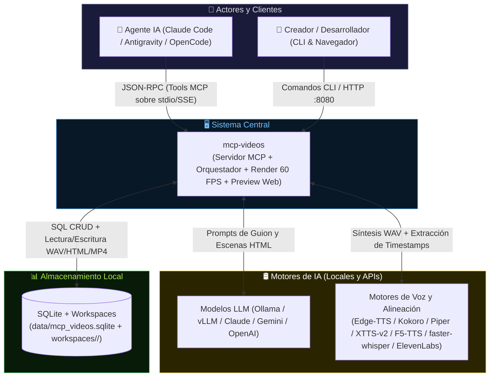

**Decisiones arquitectónicas clave (Nivel Macro):**
- **Motor de persistencia:** Se eligió **SQLite en modo WAL (`data/mcp_videos.sqlite`) combinado con directorios de workspace en disco (`workspaces/<slug>/`)** porque coordina transaccionalmente los metadatos temporales (`start_ms`, `end_ms`, `word_timestamps`) mientras mantiene los binarios multimedia (`.wav`, `.html`, `.mp4`) accesibles directamente por FFmpeg y Chromium. Se descartó guardar blobs binarios en la base de datos por penalización de E/S y tamaño.
- **Separación de interfaces ↔ núcleo de dominio:** Se eligió un **núcleo desacoplado en Python (`src/mcp_videos/core/`)** consumido simultáneamente por tres adaptadores de entrada: Servidor MCP (`FastMCP`), CLI (`Typer`) y Estudio Web (`FastAPI`). Se descartó acoplar la lógica de renderizado dentro de los handlers MCP para permitir ejecuciones por lotes en CLI y CI/CD sin agente.
- **Sincronización Audio-First y Reloj Virtual Determinista:** Se eligió **generar y medir primero el audio del diálogo y sus marcas de tiempo por palabra (`faster-whisper`)**, e inyectar un reloj virtual (`window.__setFrameTime(t)`) en el HTML capturado frame a frame con Playwright hacia FFmpeg. Se descartó la grabación de pantalla en tiempo real (`recordVideo`) porque produce caída de frames en hardware sin GPU dedicada y desincronización progresiva con la voz.
- **Abstracción híbrida Local/API para Voz y LLMs:** Se eligió un **patrón de adaptadores intercambiables** que permite operar 100% offline (con `Kokoro-ONNX`/`Piper` para diálogo rápido en CPU, `XTTS-v2`/`F5-TTS` para clonación de voz y `Ollama` para generación de escenas HTML), usar `Edge-TTS` como voz preset neuronal con fallback local, o delegar selectivamente en APIs (`Anthropic`, `Gemini`, `OpenAI`, `ElevenLabs`) mediante configuración en `.env`.

---

## 2. Componentes Internos (C4 – Nivel Contenedor)

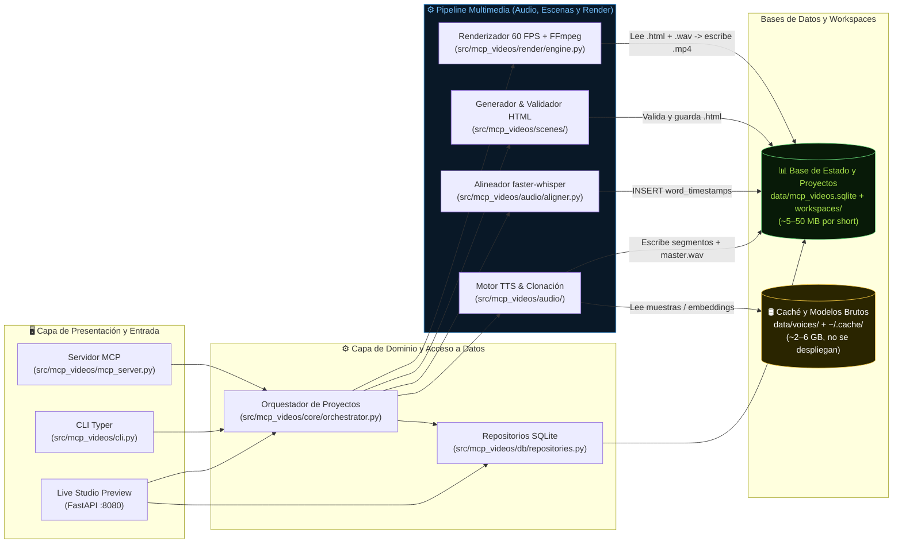

**Flujo de una interacción típica en el Estudio de Previsualización (runtime de lectura/inspección):**
1. El creador o agente abre `http://localhost:8080` y selecciona un proyecto (`antena-nasa`).
2. `WEB_PREV` consulta mediante `REPO` las tablas `projects`, `dialogue_lines`, `word_timestamps` y `scenes` en `data/mcp_videos.sqlite`.
3. El navegador carga el audio maestro (`dialogue_master.wav`) y monta en el `iframe` la escena `.html` correspondiente al instante actual (`t_ms`), invocando en cada tick `iframe.contentWindow.__setFrameTime(t_ms - scene.start_ms)` mientras resalta la palabra activa.

**Flujo de construcción de un video corto (pipeline de escritura):**
1. El agente MCP (o CLI) registra las voces en `voices` y envía los turnos del diálogo a `ORCH`.
2. `VOICE` sintetiza cada línea en `.wav`, normaliza a `-16 LUFS` y concatena `dialogue_master.wav`; enseguida `ALIGN` ejecuta `faster-whisper` y puebla `word_timestamps`.
3. Con los tiempos exactos de cada palabra, el agente MCP (o el generador LLM local/API en `SCENE`) produce los archivos `.html` de motion graphics, `SCENE` los valida en Chromium Headless y `RENDER` avanza el reloj virtual a 60 FPS enviando cada frame por pipe a `ffmpeg` para generar `output/final.mp4`.

---

## 🔄 Flujos de datos — mapa maestro

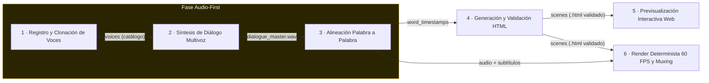

| # | Flujo | Entrada | Proceso | Salida | Detalle |
|---|---|---|---|---|---|
| **1** | Registro y Clonación de Voces | Muestra `.wav` (5–15 s) o ID de voz predefinida | Valida audio, recorta silencios, extrae/verifica perfil en motor TTS | Fila en `voices` + muestra canónica en `data/voices/` | §3 |
| **2** | Síntesis de Diálogo Multivoz | Guion por turnos (`voice_id`, `text`, `pause_ms`) | Sintetiza cada línea, normaliza a `-16 LUFS` y concatena pista maestra | Filas en `dialogue_lines` + `dialogue_master.wav` | §4 |
| **3** | Alineación Palabra a Palabra | `dialogue_master.wav` + líneas de diálogo | Transcribe y alinea con `faster-whisper` (`word_timestamps=True`) | Filas en `word_timestamps` (`start_ms`, `end_ms` por palabra) | §5 |
| **4** | Generación y Validación HTML | Cues de `word_timestamps` + prompt/código HTML | Genera/inyecta reloj virtual `__setFrameTime` y valida DOM/JS en Playwright | Archivo `scene_XX.html` + `validation_status='valid'` en `scenes` | §6 |
| **5** | Previsualización Interactiva Web | Estado del proyecto en SQLite + archivos `.wav`/`.html` | Sincroniza `<audio>` en navegador con `iframe.__setFrameTime(t)` | Vista interactiva en `http://localhost:8080` | §7 |
| **6** | Render Determinista 60 FPS y Muxing | Escenas `.html` validadas + `dialogue_master.wav` | Avanza reloj virtual frame a frame (`t = f/60`), captura y hace pipe a FFmpeg | Video `output/final.mp4` + registro en `render_jobs` | §8 |

> **Regla de oro:** **El audio manda sobre el tiempo visual (Audio-First).** Ninguna escena HTML define su duración de forma arbitraria: primero se sintetiza y mide el diálogo (`total_duration_ms` y `word_timestamps`), y todas las animaciones HTML/SVG/GSAP se anclan matemáticamente a esos milisegundos mediante el contrato `window.__setFrameTime(timeMs)`.

---

## 3. Flujo 1 — Registro y Clonación de Voces

**Entrada → Proceso → Salida:** Muestra `.wav` o ID predefinido → normalización acústica y registro de motor → perfil en tabla `voices`.

Script: `src/mcp_videos/audio/voice_registry.py`.

### 3.1 Proceso de validación y registro de perfiles de voz

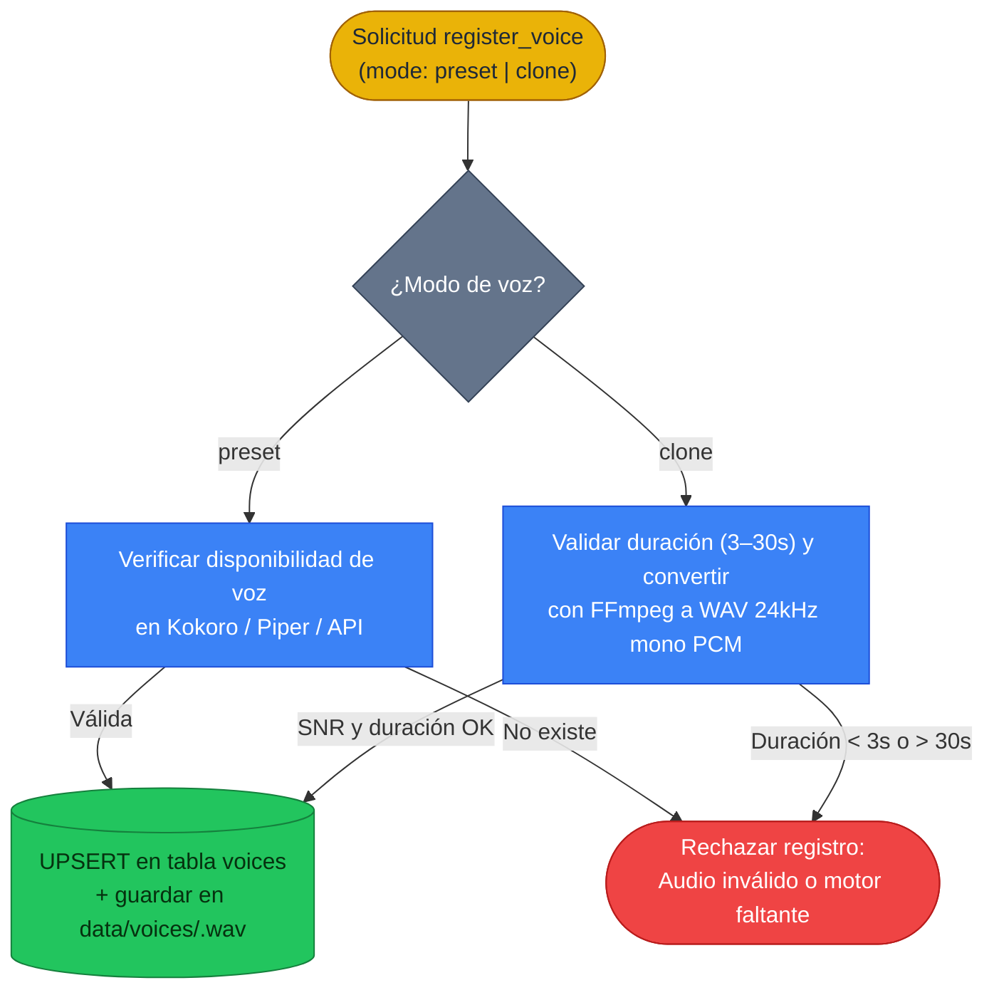

### 3.2 Reglas e invariantes

| Regla | Descripción |
|---|---|
| **Rango estricto de muestra para clonación** | Toda voz con `mode = 'clone'` exige un archivo de audio existente cuya duración efectiva tras recortar silencios esté entre `3.0 s` y `30.0 s`. Si no cumple, el registro aborta antes de tocar SQLite. |
| **Canonicalización acústica** | Las muestras de clonación nunca se leen desde rutas externas arbitrarias en tiempo de síntesis: al registrarse se copian y convierten a `data/voices/<voice_id>.wav` (`PCM 16-bit, 24000 Hz, 1 canal`). |
| **Idempotencia de catálogo** | Registrar una voz con el mismo `id` actualiza su configuración (`INSERT OR REPLACE`) sin romper las referencias foráneas en proyectos existentes. |

---

## 4. Flujo 2 — Síntesis de Diálogo Multivoz y Normalización

**Entrada → Proceso → Salida:** Guion de diálogo por turnos → síntesis TTS por hablante y mezcla `-16 LUFS` → `dialogue_master.wav`.

Script: `src/mcp_videos/audio/dialogue_synth.py`.

### 4.1 Secuencia de síntesis multivoz y ensamblado de pista maestra

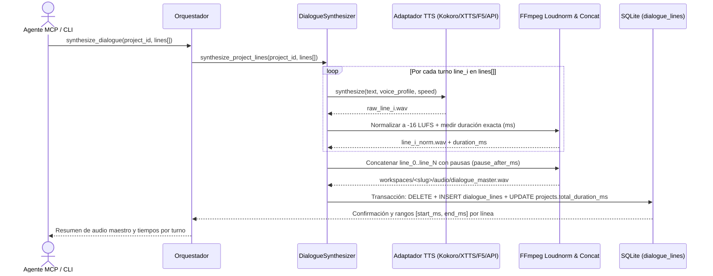

### 4.2 Reglas e invariantes

| Regla | Descripción |
|---|---|
| **Homogeneidad de sonoridad entre voces** | Cada turno individual (`line_i.wav`) se normaliza con `loudnorm=I=-16:TP=-1.5:LRA=11` antes de unirse, garantizando que una voz clonada (`XTTS`/`F5`) y una predefinida (`Kokoro`) suenen al mismo nivel. |
| **Exactitud aritmética del timeline** | Para toda línea $i$, `end_ms - start_ms` es exactamente igual a la duración en milisegundos del archivo `line_i_norm.wav` medida por muestras de audio, y `projects.total_duration_ms` coincide exactamente con la duración de `dialogue_master.wav`. |

---

## 5. Flujo 3 — Alineación Temporal Palabra a Palabra

**Entrada → Proceso → Salida:** `dialogue_master.wav` y turnos → alineación acústica con `faster-whisper` → marcas por palabra en `word_timestamps`.

Script: `src/mcp_videos/audio/aligner.py`.

### 5.1 Pipeline de extracción de timestamps por palabra

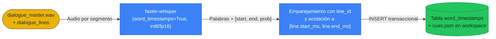

### 5.2 Reglas e invariantes

| Regla | Descripción |
|---|---|
| **Monotonía temporal estricta** | Para toda palabra $k$ dentro de una línea, se cumple siempre `0 <= start_ms < end_ms` y `word[k].end_ms <= word[k+1].start_ms` (sin inversión ni solapamiento de palabras del mismo turno). |
| **Fallback determinista ante silencio o fallo de ASR** | Si `faster-whisper` no detecta alguna palabra puntual de `text_content` (por ejemplo, una sigla corta), el alineador interpola proporcionalmente su intervalo `[start_ms, end_ms]` según su longitud en caracteres dentro de los límites del turno para que ninguna palabra del guion quede sin timestamp. |

---

## 6. Flujo 4 — Generación y Validación DOM/JS de Escenas HTML

**Entrada → Proceso → Salida:** Timestamps y especificación visual → generación/inyección de reloj virtual y prueba en Playwright → `scene_XX.html` validada.

Script: `src/mcp_videos/scenes/validator.py` y `src/mcp_videos/scenes/generator.py`.

### 6.1 Ciclo de validación y compuerta de calidad DOM/JS

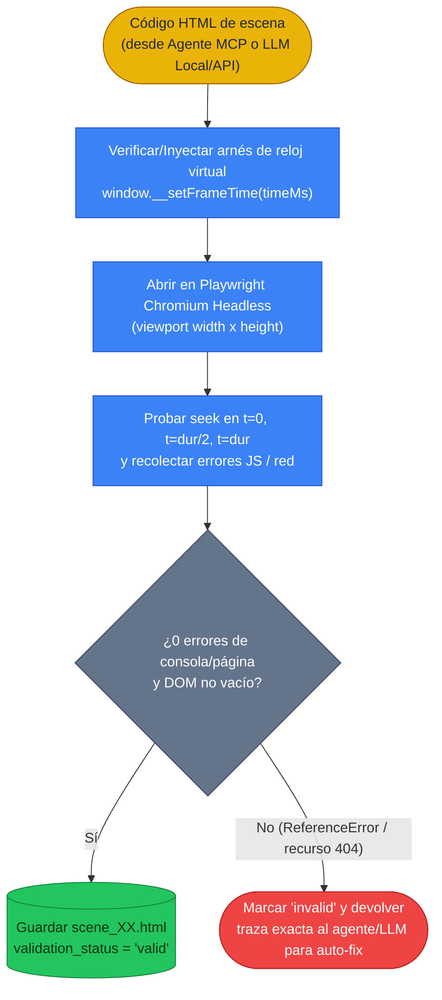

### 6.2 Reglas e invariantes

| Regla | Descripción |
|---|---|
| **Compuerta de reloj virtual (`__setFrameTime`)** | Ninguna escena puede pasar a `validation_status = 'valid'` si `typeof window.__setFrameTime !== 'function'` o si invocarla en `t = 0`, `t = (end_ms - start_ms)/2` y `t = end_ms - start_ms` lanza una excepción en la página. |
| **Cero errores silenciosos de consola o red** | Cualquier evento `pageerror` o fallo de carga de un script/hoja de estilo durante la validación marca la escena como `invalid` y devuelve el diagnóstico estructurado para que el agente MCP lo corrija antes de permitir el render. |

---

## 7. Flujo 5 — Previsualización Interactiva en Estudio Web

**Entrada → Proceso → Salida:** Estado SQLite y artefactos del workspace → sincronización en vivo Audio ↔ Iframe → previsualización en navegador.

Script: `src/mcp_videos/preview/server.py`.

### 7.1 Sincronización del reproductor web con las escenas HTML

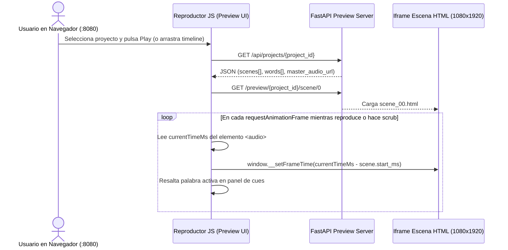

### 7.2 Reglas e invariantes

| Regla | Descripción |
|---|---|
| **Modo solo lectura sobre el modelo de negocio** | El servidor de previsualización nunca modifica los tiempos de diálogo ni reescribe escenas por su cuenta; lee `data/mcp_videos.sqlite` y los archivos del workspace, y solo delega en el orquestador si el usuario solicita explícitamente un job de render. |
| **Paridad exacta Preview ↔ Render Final** | El `iframe` del estudio web invoca exactamente la misma función `window.__setFrameTime(localTimeMs)` y usa el mismo viewport (`1080x1920` escalado por CSS `transform: scale(...)`) que el motor de captura Playwright, garantizando que lo visto en pantalla sea idéntico al MP4 exportado. |

---

## 8. Flujo 6 — Renderizado Determinista 60 FPS y Composición MP4

**Entrada → Proceso → Salida:** Escenas `.html` validadas y `dialogue_master.wav` → captura frame a frame a 60 FPS y pipe a FFmpeg → `final.mp4`.

Script: `src/mcp_videos/render/engine.py`.

### 8.1 Pipeline de captura determinista y codificación FFmpeg

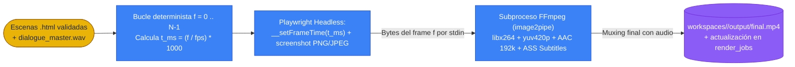

### 8.2 Reglas e invariantes

| Regla | Descripción |
|---|---|
| **Precondición de escenas validadas** | El motor de render rechaza iniciar cualquier trabajo (`render_jobs`) si alguna escena del proyecto tiene `validation_status != 'valid'` o si existen huecos temporales en `[0, total_duration_ms]`. |
| **Determinismo de tasa de cuadros (0 dropped frames)** | El reloj nunca avanza según el tiempo de pared (`wall-clock`), sino por índice discreto de frame $f \in [0, N-1]$. FFmpeg espera en su `stdin` hasta que Playwright entregue el screenshot de cada instante $t_f$, asegurando `60.00 FPS` constantes incluso en equipos solo con CPU. |
| **Compatibilidad universal del contenedor MP4** | Todo video exportado se codifica con `-c:v libx264 -pix_fmt yuv420p -movflags +faststart -c:a aac -b:a 192k`, garantizando reproducción inmediata en YouTube Shorts, TikTok, Instagram Reels y navegadores web. |

---

## 9. Modelo de datos — Esquema lógico

**El diccionario completo** (todas las columnas, tipos, restricciones `CHECK`, índices y matriz CRUD) vive en [`docs/db/diseno_db.md`](../db/diseno_db.md).

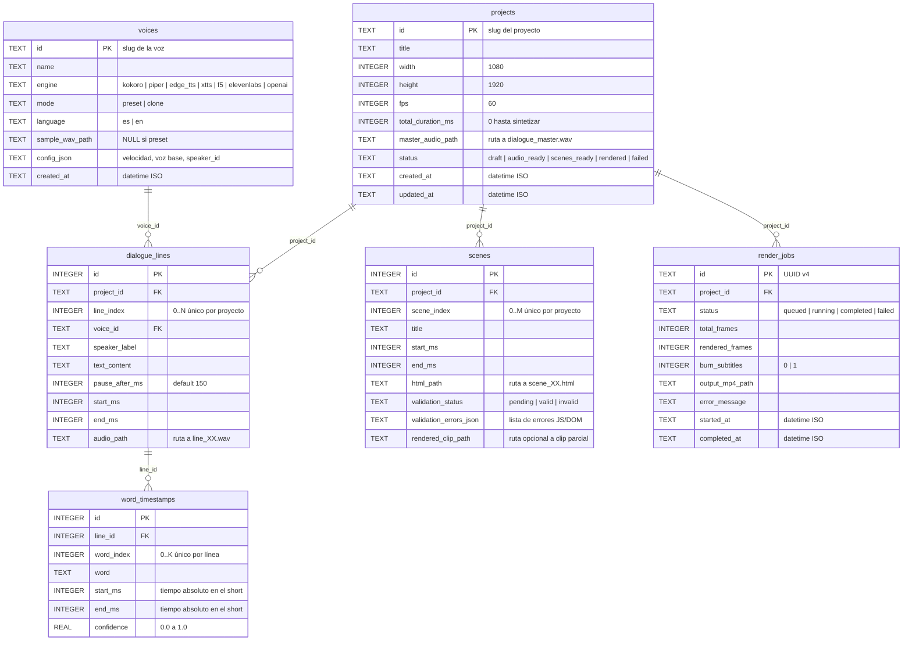

**Significado de las claves principales por entidad:**

| Entidad / Tabla | Clave Primaria | Significado |
|---|---|---|
| `voices` | `id` (`TEXT`) | Identificador semántico legible por el agente/usuario (ej. `es-narrador-kokoro`, `clon-stupy`). |
| `projects` | `id` (`TEXT`) | Slug único del proyecto que coincide 1:1 con la carpeta `workspaces/<id>/`. |
| `dialogue_lines`, `word_timestamps`, `scenes` | `id` (`INTEGER`) + ` UNIQUE(parent_id, *_index)` | Clave sustituta autoincremental con restricción de unicidad por orden secuencial dentro del proyecto o línea. |

---

## 10. Arquitectura de despliegue

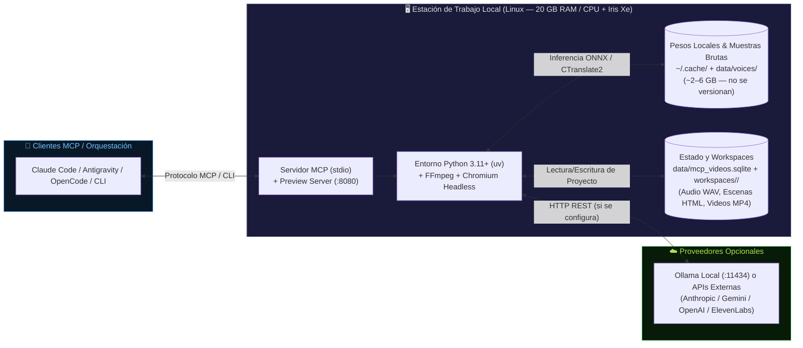

**Notas de despliegue y operación:**
- **Bundle del repositorio:** Entra al control de versiones el código fuente (`src/mcp_videos/`), migraciones SQL (`src/mcp_videos/db/migrations/`), plantillas base de escenas HTML/JS (`src/mcp_videos/scenes/templates/`), tests (`tests/`) y la especificación compartible (`docs/description_proyecto.md`, `docs/architecture/`, `docs/db/`, `docs/ejecucion.md`). Se excluyen `data/`, `workspaces/`, `.venv/` y archivos de trabajo internos si `VERSION_WORK=no`.
- **Credenciales:** Se administran exclusivamente mediante `.env` local (basado en `.env.example`), nunca en el código ni en SQLite.
- **Ejecución de modelos locales en CPU / iGPU:** En máquinas sin GPU NVIDIA dedicada, el sistema opera sin configuración extra usando `edge-tts`/`kokoro-onnx`/`piper` para síntesis rápida y `faster-whisper` en `int8`, descargando los pesos bajo demanda en la caché del usuario.

---

## 11. Decisiones arquitectónicas (ADRs)

| Decisión Tomada | Alternativa Descartada | Razón Principal |
|---|---|---|
| **ADR-01: Pipeline Audio-First gobernado por timestamps de palabra (`faster-whisper`)** | Diseñar primero la animación HTML con duraciones fijas y ajustar la velocidad del TTS después | Forzar la velocidad del TTS para encajar en una animación pre-hecha degrada la prosodia natural del habla (suena robótico o acelerado). Medir primero el audio real y pasar los `word_timestamps` al generador HTML produce sincronía exacta al estilo *Stupy Doo*. |
| **ADR-02: Captura Frame-a-Frame con Reloj Virtual (`window.__setFrameTime`) y pipe a FFmpeg** | Grabación de pantalla en tiempo real con `playwright.record_video` o `MediaRecorder` | En grabación en tiempo real, cualquier pico de CPU (común al renderizar SVG complejos o shaders en una gráfica integrada Intel Iris Xe) causa caída de frames y desfase acumulativo entre audio y video. El reloj virtual desacopla el tiempo del video del tiempo de cómputo: cada frame $f$ se renderiza y captura sin prisa a 60 FPS exactos. |
| **ADR-03: Escenas en HTML5/CSS/SVG/GSAP autocontenidas en lugar de proyectos React/Remotion** | Generar componentes `.tsx` de Remotion y compilar con Webpack/Esbuild por escena | Los LLMs (especialmente modelos locales vía Ollama) generan un único archivo `.html` autocontenido ("estilo Claude Artifact") con una tasa de éxito muy superior y cero latencia de compilación respecto a un árbol de componentes React/TypeScript con múltiples imports. |
| **ADR-04: Arquitectura de Adaptadores Multi-Backend para TTS (`Preset CPU` + `Clone Zero-Shot` + `API`)** | Usar únicamente un modelo pesado de clonación (`XTTS-v2` / `F5-TTS`) para todos los casos | En equipos sin GPU CUDA, los modelos zero-shot tardan varios segundos por frase; al incluir `Kokoro-ONNX`/`Piper` para voces predeterminadas, el usuario puede iterar diálogos completos en menos de 2 segundos en CPU y activar el motor de clonación solo para las voces clonadas específicas. |
| **ADR-05: Estado relacional en SQLite + binarios multimedia en `workspaces/<slug>/`** | Guardar todo en archivos JSON sueltos o meter los `.wav`/`.mp4` como `BLOB` en SQLite | SQLite aporta integridad referencial (`FOREIGN KEY`), consultas rápidas de palabras por rango de tiempo (`WHERE start_ms BETWEEN ...`) e invalidación automática de escenas cuando cambia una línea de diálogo, mientras que dejar los `.wav` y `.mp4` en disco permite que FFmpeg y el servidor HTTP hagan streaming directo sin copias en memoria. |

---

## Guía rápida: qué va dónde

| Tipo de contenido | Archivo |
|---|---|
| Historia de construcción por fase / sprint | `docs/task/fases/FNN-*.md` |
| Flujos de datos y arquitectura viva | `docs/architecture/architecture.md` |
| Diccionario completo de columnas de BD | `docs/db/diseno_db.md` |
| Incidentes, diagnósticos, refactors | `docs/logs/log.md` |
| Plan Maestro de implementación | `docs/plan/plan_maestro.md` |
| Guía de ejecución paso a paso | `docs/ejecucion.md` |
