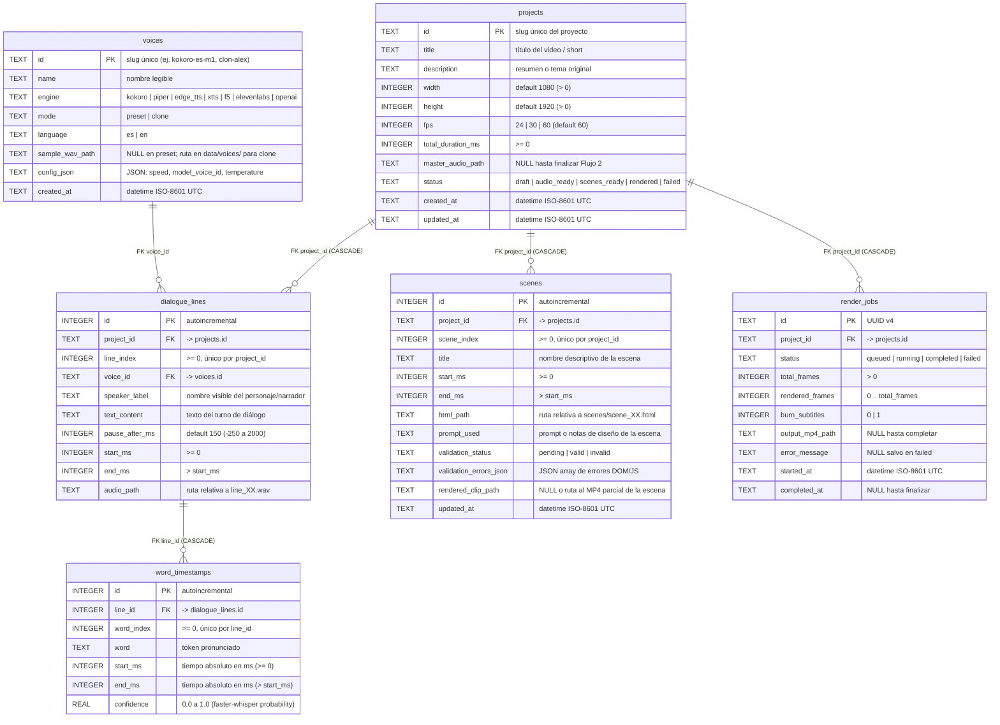

# Diseño de Bases de Datos y Persistencia — mcp-videos

> **Propósito:** Especificación física y lógica del almacenamiento de `mcp-videos`. Define el mapa de bases y almacenes de artefactos, el diagrama entidad-relación (ER), las políticas de escritura, el diccionario exhaustivo de columnas de `data/mcp_videos.sqlite` y la matriz de acceso CRUD por componente. Los flujos técnicos que alimentan estas tablas se documentan en [`docs/architecture/architecture.md`](../architecture/architecture.md).
>
> **Autor:** Alex Prieto Romani <alexprieto1997@gmail.com>

---

## Mapa de bases de datos y almacenes

| Archivo / Almacén | Tipo | Descripción | Tamaño aprox. | ¿Se despliega / versiona? |
|---|---|---|---|---|
| `src/mcp_videos/db/migrations/*.sql` | Esquema DDL | Migraciones SQL versionadas e idempotentes que crean la estructura de la base SQLite. | ~15 KB | **Sí** (en Git) |
| `data/mcp_videos.sqlite` | Consumo / Transaccional | Catálogo de voces, proyectos, guiones por línea, marcas de tiempo por palabra (`word_timestamps`), escenas HTML y jobs de renderizado. | ~2–25 MB | **No** (se genera en local) |
| `data/voices/<voice_id>.wav` | Bruta (Semillas acústicas) | Muestras de audio canónicas (`24 kHz, 16-bit mono PCM`) utilizadas para clonación de voz local (`XTTS-v2` / `F5-TTS`). | ~1–5 MB por voz | **No** |
| `workspaces/<project_id>/` | Consumo (Artefactos multimedia) | Audios por turno (`audio/line_XX.wav`), pista maestra (`audio/dialogue_master.wav`), escenas (`scenes/scene_XX.html`) y videos exportados (`output/final.mp4`). | ~10–80 MB por short | **No** |

---

## 1. Esquema lógico general

### 1.1 Diagrama ER — `data/mcp_videos.sqlite`

### 1.2 Políticas de escritura

| Tabla | Política de escritura | Quién escribe (Módulo / Flujo) | Con qué frecuencia |
|---|---|---|---|
| `voices` | `INSERT OR REPLACE` (`UPSERT` por `id`) | `src/mcp_videos/audio/voice_registry.py` (Flujo 1) | Al inicializar catálogo por defecto o registrar una nueva voz clonada/API. |
| `projects` | `INSERT` al crear; `UPDATE` transaccional de `status`, `total_duration_ms` y `updated_at` | `src/mcp_videos/core/orchestrator.py` (Flujos 2, 4 y 6) | Al crear proyecto y al completar cada etapa del pipeline. |
| `dialogue_lines` | `DELETE WHERE project_id = ?` + `INSERT` en lote dentro de una transacción | `src/mcp_videos/audio/dialogue_synth.py` (Flujo 2) | Cada vez que se sintetiza o regenera el diálogo del proyecto. |
| `word_timestamps` | `DELETE` en cascada por `line_id` + `INSERT` masivo transaccional | `src/mcp_videos/audio/aligner.py` (Flujo 3) | Inmediatamente después de generar `dialogue_master.wav`. |
| `scenes` | `INSERT ... ON CONFLICT(project_id, scene_index) DO UPDATE` | `src/mcp_videos/scenes/validator.py` (Flujo 4) | Cada vez que el agente MCP o el generador LLM crea o edita una escena `.html`. |
| `render_jobs` | `INSERT` al encolar (`queued`); `UPDATE` de progreso (`rendered_frames`) y cierre (`completed` / `failed`) | `src/mcp_videos/render/engine.py` (Flujo 6) | Por cada solicitud de exportación a MP4. |

> **Regla crítica de invalidación en cascada:** Cuando se regenera el diálogo de un proyecto en `dialogue_lines` (Flujo 2), una sentencia dentro de la misma transacción marca `UPDATE scenes SET validation_status = 'pending', rendered_clip_path = NULL WHERE project_id = :project_id`, obligando a revalidar las escenas frente a los nuevos `word_timestamps` antes de volver a exportar.

### 1.3 Significado de la clave primaria por tabla

| Tabla | Clave Primaria | Tipo | Significado de negocio |
|---|---|---|---|
| `voices` | `id` | `TEXT` | Slug canónico de la voz (`[a-z0-9-]+`), utilizado directamente en los prompts y payloads MCP. |
| `projects` | `id` | `TEXT` | Slug del proyecto (`[a-z0-9-]+`), idéntico al nombre del directorio `workspaces/<id>/`. |
| `dialogue_lines` | `id` | `INTEGER` | Identificador técnico interno; la clave natural de negocio es el par único `(project_id, line_index)`. |
| `word_timestamps` | `id` | `INTEGER` | Identificador técnico interno; la clave natural es el par único `(line_id, word_index)`. |
| `scenes` | `id` | `INTEGER` | Identificador técnico interno; la clave natural de negocio es el par único `(project_id, scene_index)`. |
| `render_jobs` | `id` | `TEXT` | UUID v4 generado al iniciar la tarea de renderizado para seguimiento asíncrono o por CLI. |

---

## 2. Base Transaccional Principal — `data/mcp_videos.sqlite`

**Origen:** Generada y mantenida localmente mediante el runner de migraciones SQL (`src/mcp_videos/db/connection.py`) con `PRAGMA journal_mode = WAL;` y `PRAGMA foreign_keys = ON;`.

### 2.1 Particularidades y configuración del motor

- **Integridad referencial estricta:** Toda conexión abre ejecutando `PRAGMA foreign_keys = ON;`. Borrar un proyecto en `projects` elimina en cascada sus filas en `dialogue_lines`, `word_timestamps`, `scenes` y `render_jobs`, pero **nunca** elimina las voces de `voices`.
- **Unidades temporales unificadas:** Todos los tiempos (`start_ms`, `end_ms`, `pause_after_ms`, `total_duration_ms`) se almacenan como enteros en **milisegundos (`INTEGER`)** para evitar errores de redondeo en coma flotante al calcular frames a 60 FPS.

### 2.2 Diccionario de columnas por tabla

#### Tabla `voices` — Catálogo de voces predefinidas y clonadas

| Columna | Tipo SQLite | Unidad / Valores permitidos | Restricciones | Notas |
|---|---|---|---|---|
| `id` | `TEXT` | Slug `[a-z0-9-]+` | `PRIMARY KEY` | Ej: `kokoro-es-dora`, `clon-narrador` |
| `name` | `TEXT` | Texto libre | `NOT NULL` | Nombre descriptivo de la voz |
| `engine` | `TEXT` | `'kokoro' \| 'piper' \| 'edge_tts' \| 'xtts' \| 'f5' \| 'elevenlabs' \| 'openai'` | `NOT NULL CHECK(...)` | Motor de síntesis responsable |
| `mode` | `TEXT` | `'preset' \| 'clone'` | `NOT NULL CHECK(...)` | Predefinida del motor o clonada desde muestra |
| `language` | `TEXT` | Código ISO (`'es'`, `'en'`) | `NOT NULL DEFAULT 'es'` | Idioma principal de síntesis |
| `sample_wav_path` | `TEXT` | Ruta relativa en `data/voices/` | `NULL` en `preset`; obligatorio si `mode = 'clone'` | Validado por `CHECK (mode = 'preset' OR sample_wav_path IS NOT NULL)` |
| `config_json` | `TEXT` | Objeto JSON serializado | `NOT NULL DEFAULT '{}'` | Parámetros específicos del motor (`speed`, `voice_code`, `stability`) |
| `created_at` | `TEXT` | ISO-8601 UTC | `NOT NULL DEFAULT (strftime('%Y-%m-%dT%H:%M:%SZ', 'now'))` | Fecha de alta |

#### Tabla `projects` — Proyectos de video / Shorts

| Columna | Tipo SQLite | Unidad / Valores permitidos | Restricciones | Notas |
|---|---|---|---|---|
| `id` | `TEXT` | Slug `[a-z0-9-]+` | `PRIMARY KEY` | Coincide con `workspaces/<id>/` |
| `title` | `TEXT` | Texto libre | `NOT NULL` | Título del short (ej. *"La antena más rara de la NASA"*) |
| `description` | `TEXT` | Texto libre | ` NOT NULL DEFAULT ''` | Idea central o prompt base |
| `width` | `INTEGER` | Píxeles (`1080` para Shorts) | `NOT NULL DEFAULT 1080 CHECK (width > 0)` | Ancho del viewport Chromium y del MP4 |
| `height` | `INTEGER` | Píxeles (`1920` para Shorts) | `NOT NULL DEFAULT 1920 CHECK (height > 0)` | Alto del viewport Chromium y del MP4 |
| `fps` | `INTEGER` | `24 \| 30 \| 60` | `NOT NULL DEFAULT 60 CHECK (fps IN (24, 30, 60))` | Cuadros por segundo deterministas |
| `total_duration_ms` | `INTEGER` | Milisegundos (`>= 0`) | `NOT NULL DEFAULT 0 CHECK (total_duration_ms >= 0)` | Duración exacta de `dialogue_master.wav` |
| `master_audio_path` | `TEXT` | Ruta relativa a `.wav` | `NULL` en `draft` | Se llena al concluir el Flujo 2 |
| `status` | `TEXT` | `'draft' \| 'audio_ready' \| 'scenes_ready' \| 'rendered' \| 'failed'` | `NOT NULL DEFAULT 'draft' CHECK(...)` | Estado en la máquina de estados del proyecto |
| `created_at` | `TEXT` | ISO-8601 UTC | `NOT NULL` | Timestamp de creación |
| `updated_at` | `TEXT` | ISO-8601 UTC | `NOT NULL` | Última modificación |

#### Tabla `dialogue_lines` — Turnos del guion dialogado

| Columna | Tipo SQLite | Unidad / Valores permitidos | Restricciones | Notas |
|---|---|---|---|---|
| `id` | `INTEGER` | Entero | `PRIMARY KEY AUTOINCREMENT` | Clave sustituta |
| `project_id` | `TEXT` | FK → `projects.id` | `NOT NULL ON DELETE CASCADE` | Proyecto al que pertenece |
| `line_index` | `INTEGER` | `0, 1, 2, ...` | `NOT NULL CHECK (line_index >= 0)` | `UNIQUE(project_id, line_index)` |
| `voice_id` | `TEXT` | FK → `voices.id` | `NOT NULL ON DELETE RESTRICT` | Voz que interpreta la línea |
| `speaker_label` | `TEXT` | Texto libre | `NOT NULL` | Etiqueta del hablante (ej. `Narrador`, `Ingeniero`) |
| `text_content` | `TEXT` | Texto no vacío | `NOT NULL CHECK (length(trim(text_content)) > 0)` | Texto a pronunciar y subtitular |
| `pause_after_ms` | `INTEGER` | `-250` a `2000` ms | `NOT NULL DEFAULT 150 CHECK (pause_after_ms BETWEEN -250 AND 2000)` | Pausa (o solapamiento negativo) tras la línea |
| `start_ms` | `INTEGER` | Milisegundos (`>= 0`) | `NOT NULL CHECK (start_ms >= 0)` | Inicio exacto en `dialogue_master.wav` |
| `end_ms` | `INTEGER` | Milisegundos (`> start_ms`) | `NOT NULL CHECK (end_ms > start_ms)` | Fin exacto en `dialogue_master.wav` |
| `audio_path` | `TEXT` | Ruta a `line_XX.wav` | `NOT NULL` | Segmento individual normalizado a `-16 LUFS` |

#### Tabla `word_timestamps` — Alineación temporal palabra por palabra

| Columna | Tipo SQLite | Unidad / Valores permitidos | Restricciones | Notas |
|---|---|---|---|---|
| `id` | `INTEGER` | Entero | `PRIMARY KEY AUTOINCREMENT` | Clave sustituta |
| `line_id` | `INTEGER` | FK → `dialogue_lines.id` | `NOT NULL ON DELETE CASCADE` | Línea de diálogo origen |
| `word_index` | `INTEGER` | `0, 1, 2, ...` | `NOT NULL CHECK (word_index >= 0)` | `UNIQUE(line_id, word_index)` |
| `word` | `TEXT` | Palabra o token | `NOT NULL` | Texto exacto de la palabra |
| `start_ms` | `INTEGER` | Milisegundos (`>= 0`) | `NOT NULL CHECK (start_ms >= 0)` | Tiempo absoluto desde el inicio del short |
| `end_ms` | `INTEGER` | Milisegundos (`> start_ms`) | `NOT NULL CHECK (end_ms > start_ms)` | Fin de pronunciación de la palabra |
| `confidence` | `REAL` | `0.0` a `1.0` | `NOT NULL DEFAULT 1.0 CHECK (confidence BETWEEN 0.0 AND 1.0)` | Probabilidad reportada por `faster-whisper` (o `0.5` si fue interpolada) |

#### Tabla `scenes` — Escenas HTML Motion Graphics

| Columna | Tipo SQLite | Unidad / Valores permitidos | Restricciones | Notas |
|---|---|---|---|---|
| `id` | `INTEGER` | Entero | `PRIMARY KEY AUTOINCREMENT` | Clave sustituta |
| `project_id` | `TEXT` | FK → `projects.id` | `NOT NULL ON DELETE CASCADE` | Proyecto dueño de la escena |
| `scene_index` | `INTEGER` | `0, 1, 2, ...` | `NOT NULL CHECK (scene_index >= 0)` | `UNIQUE(project_id, scene_index)` |
| `title` | `TEXT` | Texto libre | `NOT NULL` | Nombre de la escena (ej. `Hook Antena Evolucionada`) |
| `start_ms` | `INTEGER` | Milisegundos (`>= 0`) | `NOT NULL CHECK (start_ms >= 0)` | Inicio de la escena en el timeline global |
| `end_ms` | `INTEGER` | Milisegundos (`> start_ms`) | `NOT NULL CHECK (end_ms > start_ms)` | Fin de la escena en el timeline global |
| `html_path` | `TEXT` | Ruta a `scene_XX.html` | `NOT NULL` | Archivo HTML5/CSS/SVG/GSAP autocontenido |
| `prompt_used` | `TEXT` | Texto libre | `NOT NULL DEFAULT ''` | Instrucción visual o notas del agente |
| `validation_status` | `TEXT` | `'pending' \| 'valid' \| 'invalid'` | `NOT NULL DEFAULT 'pending' CHECK(...)` | Resultado del gate DOM/JS en Playwright |
| `validation_errors_json` | `TEXT` | JSON array | `NOT NULL DEFAULT '[]'` | Errores JS/consola capturados si `invalid` |
| `rendered_clip_path` | `TEXT` | Ruta opcional a `.mp4` parcial | `NULL` si aún no se renderizó la escena | Permite caché de render por escena |
| `updated_at` | `TEXT` | ISO-8601 UTC | `NOT NULL` | Timestamp de última edición del `.html` |

#### Tabla `render_jobs` — Historial y estado de trabajos de renderizado

| Columna | Tipo SQLite | Unidad / Valores permitidos | Restricciones | Notas |
|---|---|---|---|---|
| `id` | `TEXT` | UUID v4 | `PRIMARY KEY` | Identificador del job |
| `project_id` | `TEXT` | FK → `projects.id` | `NOT NULL ON DELETE CASCADE` | Proyecto renderizado |
| `status` | `TEXT` | `'queued' \| 'running' \| 'completed' \| 'failed'` | `NOT NULL CHECK(...)` | Estado de ejecución |
| `total_frames` | `INTEGER` | Frames (`> 0`) | `NOT NULL CHECK (total_frames > 0)` | Total de cuadros a capturar a 60 FPS |
| `rendered_frames` | `INTEGER` | Frames (`>= 0`) | `NOT NULL DEFAULT 0 CHECK (rendered_frames >= 0)` | Progreso actual del job |
| `burn_subtitles` | `INTEGER` | `0 \| 1` | `NOT NULL DEFAULT 1 CHECK (burn_subtitles IN (0, 1))` | Si incrusta subtítulos dinámicos desde `word_timestamps` |
| `output_mp4_path` | `TEXT` | Ruta a `final.mp4` | `NULL` hasta `completed` | Ruta final del video exportado |
| `error_message` | `TEXT` | Traza de error | `NULL` salvo en `failed` | Diagnóstico si falla FFmpeg o Chromium |
| `started_at` | `TEXT` | ISO-8601 UTC | `NOT NULL` | Inicio del job |
| `completed_at` | `TEXT` | ISO-8601 UTC | `NULL` mientras corre | Fin del job |

---

## 3. Acceso CRUD por componente

| Tabla | Escritor (Módulo) | Lector (Módulo) | ¿Se incluye en Git? |
|---|---|---|---|
| `voices` | `audio/voice_registry.py` (`UPSERT`) | `audio/dialogue_synth.py`, `mcp_server.py`, `preview/server.py` | **No** (solo el seed inicial por código) |
| `projects` | `core/orchestrator.py` (`INSERT` / `UPDATE`) | Todos los módulos (`mcp_server`, `cli`, `preview`, `render`) | **No** |
| `dialogue_lines` | `audio/dialogue_synth.py` (`DELETE + INSERT`) | `audio/aligner.py`, `scenes/generator.py`, `preview/server.py` | **No** |
| `word_timestamps` | `audio/aligner.py` (`INSERT` masivo) | `scenes/generator.py`, `render/subtitles.py`, `preview/server.py` | **No** |
| `scenes` | `scenes/validator.py` (`UPSERT`), `render/engine.py` | `render/engine.py`, `preview/server.py`, `mcp_server.py` | **No** |
| `render_jobs` | `render/engine.py` (`INSERT` / `UPDATE`) | `mcp_server.py`, `cli.py`, `preview/server.py` | **No** |

---

## 4. Matriz de motores de voz vs. columnas especiales

En la tabla `voices`, el esquema es homogéneo pero el significado de `sample_wav_path` y los campos de `config_json` varían intencionalmente según el motor (`engine`) y el modo (`mode`):

| Campo / Columna | `kokoro` / `piper` / `edge_tts` (`preset`) | `xtts` / `f5` (`clone`) | `elevenlabs` / `openai` (`preset` o `clone`) |
|---|---|---|---|
| `sample_wav_path` | `NULL` (usa pesos internos ONNX) | **Obligatorio** (`data/voices/<id>.wav`, 24 kHz mono) | `NULL` (usa `voice_id` remoto en la nube) |
| `config_json.voice_code` | Código interno (ej. `ef_dora`, `em_alex`, `es-ES-ElviraNeural`) | `NULL` | ID de voz en la API (ej. `alloy`, `21m00Tcm4TlvDq8ikWAM`) |
| `config_json.speed` / `rate` | `REAL` (`0.7` a `1.5`, default `1.0`); `edge_tts` acepta `rate` ASS (ej. `+15%`) | `REAL` (`0.8` a `1.3`, default `1.0`) | `REAL` (`0.7` a `1.2`, default `1.0`) |
| `config_json.ref_text` | `NULL` | Transcripción exacta del `.wav` semilla (requerido por `F5-TTS`) | `NULL` |

> El esquema homogéneo en `voices` permite que `dialogue_lines` referencie cualquier `voice_id` sin importar si un personaje del diálogo usa una voz local predefinida en CPU, una voz clonada zero-shot o una voz de API.
