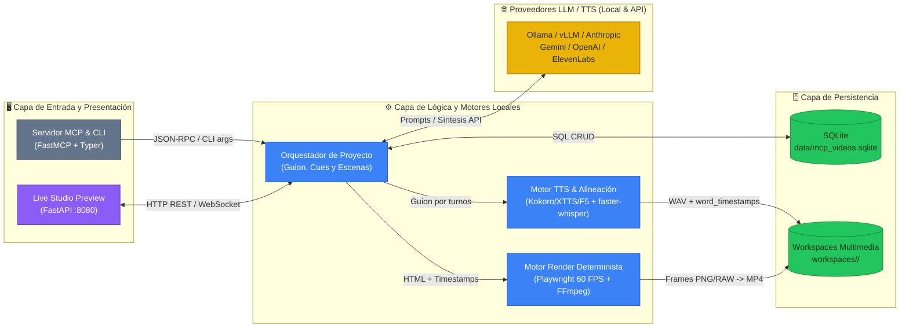
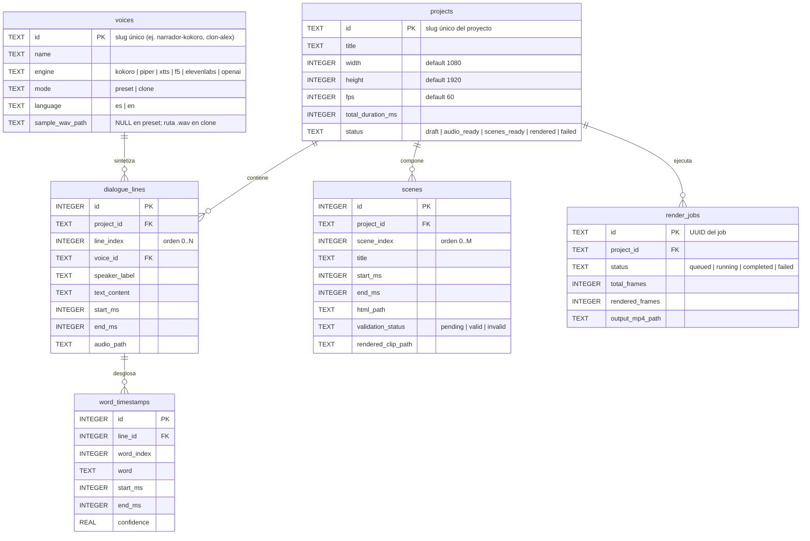

# Documento de Definición Técnica — mcp-videos

> **Propósito:** Única fuente de verdad técnica y funcional para desarrolladores, arquitectos y agentes de IA. Define qué hace el sistema, cómo están organizados sus componentes, cómo fluyen los datos y qué reglas de negocio aplica.
>
> **Autor:** Alex Prieto Romani <alexprieto1997@gmail.com>

---

## 0. Resumen ejecutivo

- **Propósito:** Permitir la creación automatizada y reproducible de videos explicativos cortos (Shorts verticales `1080x1920` y videos horizontales `1920x1080` a `60 FPS`, al estilo *Stupy Doo* / *Claude Motion Graphics*) combinando escenas programáticas en HTML5/CSS/SVG/Canvas/GSAP sincronizadas al milisegundo con diálogos multivoz generados mediante modelos locales (voces predefinidas rápidas o clonación de voz zero-shot) o APIs externas.
- **Usuarios objetivo:** Creadores de contenido técnico/científico, desarrolladores y agentes de IA (Claude Code, Antigravity, OpenCode, Cursor) que operan el sistema vía protocolo MCP, línea de comandos (CLI) o estudio web de previsualización.
- **Casos de uso principales:**
  1. **Clonación y registro de voces para diálogo:** El usuario registra una muestra de audio `.wav` (5–15 s) o selecciona voces predeterminadas (`Kokoro-ONNX` / `Piper` / `XTTS-v2` / `F5-TTS` / APIs) → el sistema valida la señal, extrae/cachea el perfil acústico y lo deja disponible en el catálogo SQLite para múltiples personajes.
  2. **Síntesis de diálogo multivoz y alineación palabra por palabra (Audio-First):** Un agente MCP o el orquestador LLM envía el guion estructurado por turnos → el sistema sintetiza cada línea con su voz asignada, normaliza el volumen a `-16 LUFS`, ensambla el audio maestro (`dialogue_master.wav`) y extrae con `faster-whisper` las marcas de tiempo exactas (`start_ms`, `end_ms`) de cada palabra.
  3. **Generación de escenas HTML Motion Graphics y renderizado determinista a MP4:** El agente MCP (o un LLM local vía Ollama/vLLM o API) diseña escenas `.html` autocontenidas ancladas a los `word_timestamps` y al reloj virtual `window.__setFrameTime(t)` → el sistema valida el DOM/JS en headless browser, permite previsualizar en vivo y renderiza el video a `60 FPS` exactos inyectando el reloj frame a frame hacia FFmpeg.

---

## 1. Arquitectura de componentes



### Glosario de componentes

| Componente | Responsabilidad | Tecnología | ¿Escribe o solo lee? |
|---|---|---|---|
| `Servidor MCP & CLI` | Expone tools MCP para agentes y comandos CLI para operar proyectos, voces, escenas y renders. | Python 3.11+, `mcp` (`FastMCP`), `typer` | Ambas (vía Orquestador) |
| `Live Studio Preview` | Interfaz web local para previsualizar las escenas HTML sincronizadas con el audio maestro y subtítulos antes de exportar. | `FastAPI`, `Uvicorn`, HTML/JS nativo | Solo lee artefactos / dispara recarga |
| `Orquestador de Proyecto` | Coordina el ciclo de vida Audio-First, invoca LLMs locales/APIs para guion y escenas HTML, y gestiona estados en SQLite. | Python 3.11+, `pydantic`, `httpx` | Escribe en SQLite y Workspaces |
| `Motor TTS & Alineación` | Sintetiza líneas de diálogo con voces predefinidas o clonadas, normaliza audio y extrae timestamps por palabra. | `kokoro-onnx`, `piper-tts`, `TTS`/`f5-tts`, `faster-whisper`, `ffmpeg` | Escribe `.wav` y `word_timestamps` |
| `Motor Render Determinista` | Valida el DOM/JS del HTML, inyecta el reloj virtual frame a frame (`60 FPS`) y codifica el MP4 final con audio y subtítulos. | `playwright` (Chromium Headless), `ffmpeg` (`image2pipe`) | Escribe `.mp4` y reportes de render |
| `SQLite + Workspaces` | Almacena el catálogo de voces, proyectos, líneas de diálogo, timestamps, escenas y metadatos de render. | `SQLite 3` (modo WAL) + Sistema de archivos | Persistencia central |

---

## 2. Flujos de datos

Dado que el sistema cuenta con **6 flujos técnicos encadenados**, el detalle exhaustivo de cada flujo, sus diagramas e invariantes se documenta en [`docs/architecture/architecture.md`](architecture/architecture.md).

### 2.1 Entradas y salidas

| Dirección | Fuente / Destino | Tipo de dato | Frecuencia |
|---|---|---|---|
| Entrada | Agente MCP / Usuario CLI / Prompt inicial | Tema, guion estructurado JSON/YAML o código `.html` de escena | Por proyecto / iteración |
| Entrada | Muestra de voz para clonación | Archivo de audio `.wav` / `.mp3` (5–15 s, mono/estéreo) | Al registrar nueva voz clonada |
| Entrada | Proveedores LLM / TTS (Ollama, Claude, Gemini, ElevenLabs) | Respuestas de completado (HTML/JSON) o streams de audio PCM | Por generación de escena o línea |
| Salida | Estudio de Previsualización Web (`:8080`) | Timeline interactivo HTML + Audio sincronizado | En tiempo real durante edición |
| Salida | Artefacto de video final (`workspaces/<slug>/output/final.mp4`) | Video MP4 (`H.264`, `yuv420p`, `60 FPS`, audio `AAC 192kbps`) | Por job de renderizado |

### 2.2 Diagrama de flujo principal


---

## 3. Modelo de datos

El diccionario completo de columnas, tipos, claves y políticas CRUD se encuentra en [`docs/db/diseno_db.md`](db/diseno_db.md). A continuación se presenta el esquema entidad-relación de alto nivel:



### Políticas de integridad

- **Inmutabilidad de muestras de voz clonada:** Una vez registrada una muestra base en `voices.sample_wav_path`, el archivo original se copia y normaliza dentro de `data/voices/` y no se sobreescribe en corridas de proyectos.
- **Audio-First como fuente de la verdad temporal:** `projects.total_duration_ms`, `dialogue_lines.start_ms/end_ms` y `word_timestamps` se calculan exclusivamente a partir de los archivos `.wav` reales generados y alineados. Si cambia el texto de una línea de diálogo, se invalida (`validation_status = 'pending'`) toda escena cuyo rango `[start_ms, end_ms]` se solape con dicha línea.
- **Cobertura temporal continua de escenas:** La unión de las escenas (`scenes`) de un proyecto debe cubrir sin huecos ni solapamientos el intervalo `[0, total_duration_ms]`.

---

## 4. Contratos de interfaz

### 4A. Tools del Servidor MCP y Endpoints de Preview REST

**Herramientas MCP expuestas (`FastMCP` sobre `stdio` / `sse`):**

| Tool MCP | Descripción | Entrada principal | Respuesta exitosa |
|---|---|---|---|
| `register_voice` | Registra una voz predefinida o clona una voz desde un archivo `.wav`. | `{"voice_id": "clon-host", "engine": "f5", "mode": "clone", "sample_wav_path": "..."}` | `{"voice_id": "clon-host", "status": "ready", "sample_rate": 24000}` |
| `list_voices` | Lista el catálogo de voces locales y API disponibles. | `{"language": "es"}` | `[{"voice_id": "...", "engine": "...", "mode": "..."}]` |
| `create_project` | Inicializa un nuevo proyecto de video (9:16 o 16:9, FPS) y su workspace. | `{"project_id": "antena-nasa", "title": "...", "width": 1080, "height": 1920, "fps": 60}` | `{"project_id": "antena-nasa", "workspace_dir": "workspaces/antena-nasa"}` |
| `synthesize_dialogue` | Sintetiza todas las líneas del diálogo multivoz, normaliza a `-16 LUFS` y extrae `word_timestamps` con `faster-whisper`. | `{"project_id": "antena-nasa", "lines": [{"voice_id": "...", "text": "..."}]}` | `{"total_duration_ms": 48250, "master_audio": "...", "words": [...]}` |
| `save_and_validate_scene` | Guarda o genera con LLM una escena `.html` autocontenida y verifica en Chromium Headless que cumpla el contrato `__setFrameTime(t)` sin errores JS. | `{"project_id": "antena-nasa", "scene_index": 0, "start_ms": 0, "end_ms": 12000, "html_content": "..."}` | `{"scene_id": 1, "validation_status": "valid", "console_errors": []}` |
| `render_project_video` | Ejecuta la captura determinista a 60 FPS de todas las escenas y las une con `dialogue_master.wav` en el MP4 final. | `{"project_id": "antena-nasa", "burn_subtitles": true}` | `{"job_id": "...", "output_mp4_path": "workspaces/antena-nasa/output/final.mp4", "fps": 60}` |

**Endpoints HTTP del Estudio de Previsualización (`FastAPI` en `:8080`):**

| Método | Endpoint | Descripción | Entrada | Respuesta exitosa |
|---|---|---|---|---|
| `GET` | `/api/projects/{project_id}` | Devuelve el manifiesto completo del proyecto (audio, timestamps por palabra y lista de escenas). | *Ninguna* | `{"project": {...}, "lines": [...], "words": [...], "scenes": [...]}` |
| `GET` | `/preview/{project_id}/scene/{scene_index}` | Sirve el archivo `.html` de la escena con el arnés de reloj virtual inyectado. | *Ninguna* | `text/html` autocontenido |
| `POST` | `/api/projects/{project_id}/render` | Dispara un job de renderizado determinista desde la UI de preview. | `{"scene_index": null}` | `{"job_id": "uuid", "status": "running"}` |

### 4B. Variables de configuración

```bash
# .env.example — variables requeridas y opcionales para mcp-videos
MCP_VIDEOS_DB_PATH=data/mcp_videos.sqlite
MCP_VIDEOS_WORKSPACES_DIR=workspaces
MCP_VIDEOS_VOICES_DIR=data/voices

# Dispositivo de inferencia local (cpu | cuda | auto)
LOCAL_INFERENCE_DEVICE=auto
WHISPER_MODEL_SIZE=small
WHISPER_COMPUTE_TYPE=int8

# Proveedores LLM locales (Ollama / vLLM / LM Studio)
LOCAL_LLM_BASE_URL=http://localhost:11434/v1
LOCAL_LLM_MODEL=qwen2.5-coder:14b

# Proveedores LLM y TTS por API (opcionales; solo si se usan motores cloud)
ANTHROPIC_API_KEY=
GEMINI_API_KEY=
OPENAI_API_KEY=
ELEVENLABS_API_KEY=

# Parámetros del servidor de previsualización y renderizado
PREVIEW_PORT=8080
DEFAULT_VIDEO_FPS=60
FFMPEG_CRF=18
```

---

## 5. Lógica de negocio y fórmulas

### 5.1 Índices y fórmulas calculadas

| Índice / Métrica | Fórmula | Umbrales / Restricciones |
|---|---|---|
| `Tiempo Virtual de Frame` ($t_f$) | $t_f = \frac{f}{\text{FPS}} \times 1000\text{ ms}$, para $f \in [0, N_{\text{frames}} - 1]$ | $\text{FPS} \in \{24, 30, 60\}$; $N_{\text{frames}} = \lceil \frac{\text{duración\_ms}}{1000} \times \text{FPS} \rceil$. Garantiza paso constante de $16.666\text{ ms}$ a $60\text{ FPS}$. |
| `Timeline Acumulado de Diálogo` ($S_i, E_i$) | $S_i = E_{i-1} + P_{i-1}$, $E_i = S_i + D(\text{wav}_i)$ | $S_0 = 0$; $P_i \in [-250\text{ ms}, 1500\text{ ms}]$ es la pausa (o solapamiento ligero) entre turnos; $D(\text{wav}_i)$ es la duración exacta en muestras dividida por el sample rate. |
| `Normalización de Sonoridad Integrada` | Filtro EBU R128 (`loudnorm=I=-16:TP=-1.5:LRA=11`) | Todo segmento `.wav` sintetizado (local o API) se normaliza a `-16 LUFS` y `-1.5 dBTP` antes de concatenarse para evitar saltos de volumen entre voces clonadas y predefinidas. |

### 5.2 Reglas de validación de negocio

- **Contrato obligatorio de escena HTML (`Scene Clock Contract`):** Toda escena `.html` debe definir la función global `window.__setFrameTime = function(timeMs) { ... }` (o usar el adaptador inyectado que controla GSAP/CSS Animations/RAF). Durante la validación en Playwright, el motor evalúa `__setFrameTime(0)`, `__setFrameTime(dur/2)` y `__setFrameTime(dur)`; si se produce cualquier `pageerror`, `console.error` o recurso HTTP fallido, la escena se marca como `invalid` y se bloquea el render.
- **Validación de muestra para clonación de voz:** Para motores `mode = 'clone'` (`xtts`, `f5`), el audio semilla debe tener una duración entre `3.0 s` y `30.0 s`, relación señal-ruido suficiente y convertirse automáticamente a PCM `16-bit mono 24 kHz` libre de silencios extremos al inicio y final (`silenceremove`).
- **Aislamiento y determinismo visual:** Las escenas HTML no pueden depender de llamadas `fetch()` dinámicas a APIs de datos externas durante el renderizado; todas las fuentes tipográficas, iconos SVG y librerías de animación (`GSAP`, `Anime.js`, `Three.js` o CSS) se sirven desde el caché local de assets del motor para que el render sea 100% reproducible offline.

---

## 6. Interfaz de usuario

### 6.1 Estructura de la interfaz (Live Studio Preview)

| Control | Tipo | Qué dispara |
|---|---|---|
| `Selector de Proyecto` | Dropdown superior | Carga el manifiesto del proyecto (`dialogue_master.wav`, `word_timestamps` y lista de escenas) desde `/api/projects/{id}`. |
| `Stage Viewport (9:16 / 16:9)` | `iframe` escalado con resolución nativa fija (`1080x1920`) | Renderiza la escena `.html` activa y recibe en cada tick del reproductor el llamado `iframe.contentWindow.__setFrameTime(currentTimeMs)`. |
| `Timeline Scrubber & Play/Pause` | Barra de tiempo + controles de transporte | Reproduce el audio maestro o permite arrastrar frame por frame (`+-16.67 ms`) para inspeccionar la sincronía exacta entre la voz y la animación SVG/Canvas. |
| `Inspector de Cues (Palabras)` | Panel lateral con transcripción interactiva | Resalta la palabra activa según `word_timestamps` y al hacer clic sobre cualquier palabra salta (`seek`) a su `start_ms` exacto. |
| `Botón Render MP4` | Botón de acción primaria | Envía `POST /api/projects/{id}/render` y muestra el progreso de frames capturados (`rendered_frames / total_frames`). |

### 6.2 Comportamientos reactivos clave

- **Sincronización en vivo Audio ↔ Iframe:** Cuando el usuario reproduce el audio o arrastra el slider de tiempo a `t_ms`, el reproductor identifica qué escena cubre `t_ms`, cambia el `iframe` si hubo transición de escena y ejecuta `window.__setFrameTime(t_ms - scene.start_ms)` dentro del `iframe`.
- **Hot-Reload de escena editada:** Cuando el agente MCP o el usuario actualiza un archivo `.html` mediante `save_and_validate_scene`, el estudio web recarga automáticamente esa escena manteniendo el cursor de tiempo actual (`t_ms`) para verificar el cambio visual al instante.

---

## 7. Configuración y despliegue

### 7.1 Entornos

| Entorno | Cómo arrancar | URL / acceso | Datos que usa |
|---|---|---|---|
| Servidor MCP (Integración IDE / Agentes) | `uv run python -m mcp_videos.mcp_server` | Transporte `stdio` (invocado por Claude Code / OpenCode / Antigravity) | `data/mcp_videos.sqlite` + `workspaces/` |
| Estudio de Previsualización Local | `uv run python -m mcp_videos.preview_server --port 8080` | `http://localhost:8080` | `data/mcp_videos.sqlite` + `workspaces/` |
| CLI de Pipeline / Render | `uv run python -m mcp_videos.cli render <project_id>` | Terminal local / CI | `data/mcp_videos.sqlite` + `workspaces/<project_id>/` |

### 7.2 Automatización

| Tarea | Frecuencia | Qué hace | Quién la dispara |
|---|---|---|---|
| Pipeline completo `build-short` | Por demanda (CLI o MCP) | Encadena síntesis de diálogo → alineación `faster-whisper` → validación de escenas HTML → renderizado 60 FPS → muxing MP4. | Agente de IA vía MCP o usuario por CLI |
| Verificación de calidad y tests | En cada commit / cierre de Tarea | Ejecuta `ruff check`, `ruff format --check` y `pytest` (unitarios + simulación de render y audio). | `pre-commit` / `verificar-dod` |

### 7.3 Restricciones del entorno

- **Hardware local sin GPU NVIDIA dedicada (CPU / Intel Iris Xe):** El entorno actual cuenta con 20 GB de RAM y gráficos integrados Intel Iris Xe. Por ello, `LOCAL_INFERENCE_DEVICE=auto` selecciona automáticamente `kokoro-onnx`/`piper` (CPU ONNX) y `faster-whisper` con `compute_type="int8"` por defecto, reservando motores pesados de clonación (`XTTS-v2` / `F5-TTS`) para síntesis por lotes con caché de embeddings o cuando se detecte CUDA/ROCm.
- **Exclusión de binarios y modelos pesados en Git:** Los directorios `workspaces/`, `data/voices/`, `data/*.sqlite` y los pesos descargados de HuggingFace/ONNX nunca se versionan en Git.
- **Invocación de módulos Python:** Usar siempre `uv run python -m <modulo>` para evitar problemas de resolución de `PATH` o bloqueos de binarios en distintos sistemas operativos.
